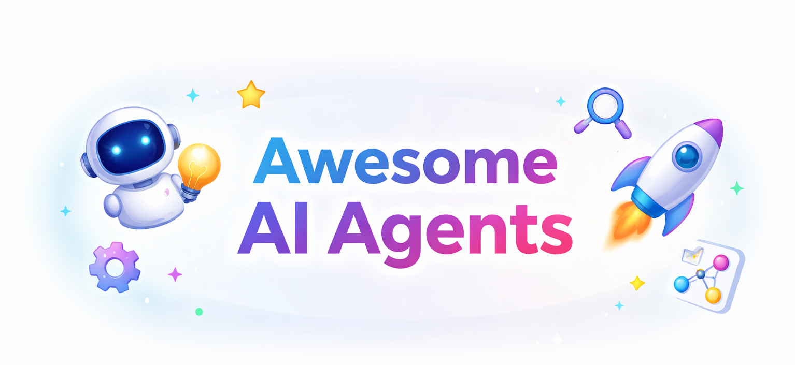

# Awesome AI Agents

This repository is a curated collection of the best AI agents, tools, and resources available today. It is maintained by the CodeAtoms community and is updated regularly to reflect the latest advancements in the field.

## 24/7 Agents
- [OpenClaw](https://github.com/openclaw/openclaw) - OpenClaw is an open-source, self-hosted, 24/7 AI agent platform that allows you to run AI agents continuously on your own infrastructure.

## Coding Agents
- [Goose](https://github.com/block/goose) - Goose is your on-machine AI agent, capable of automating complex development tasks from start to finish.

## Automation Agents
- [Social Media Agent](https://github.com/langchain-ai/Social-Media-Agent) - A human-in-the-loop AI agent for creating and publishing social media content with control and accountability.

## Finance Agents
- [Dexter](https://github.com/virattt/dexter) - Dexter is an autonomous financial research agent that thinks, plans, executes, and self-validates complex financial analysis tasks using real-time market data.

## Others
- [Integuru](https://github.com/Integuru-AI/Integuru) - First version of the AI agent that generates integration code by reverse-engineering platforms' internal APIs.

## Contributing

Contributions are welcome! Please read our [CONTRIBUTING.md](CONTRIBUTING.md) for more information.

## License

This project is licensed under the [MIT License](LICENSE).